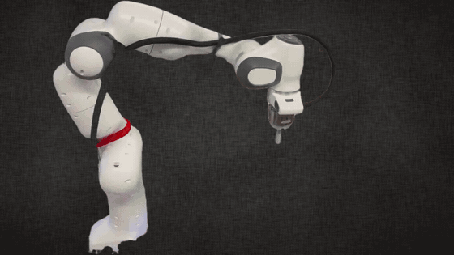
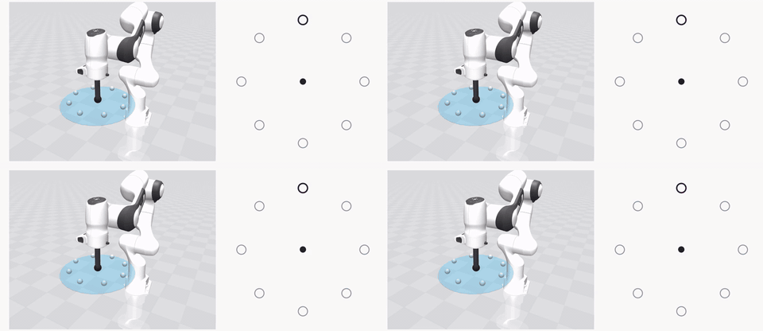
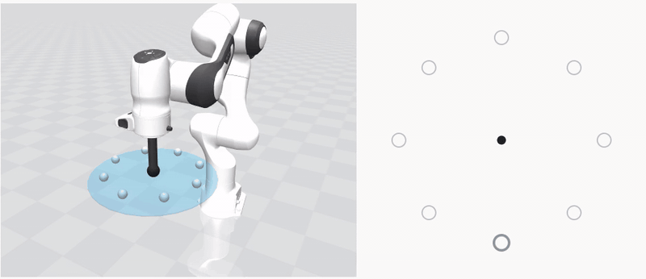
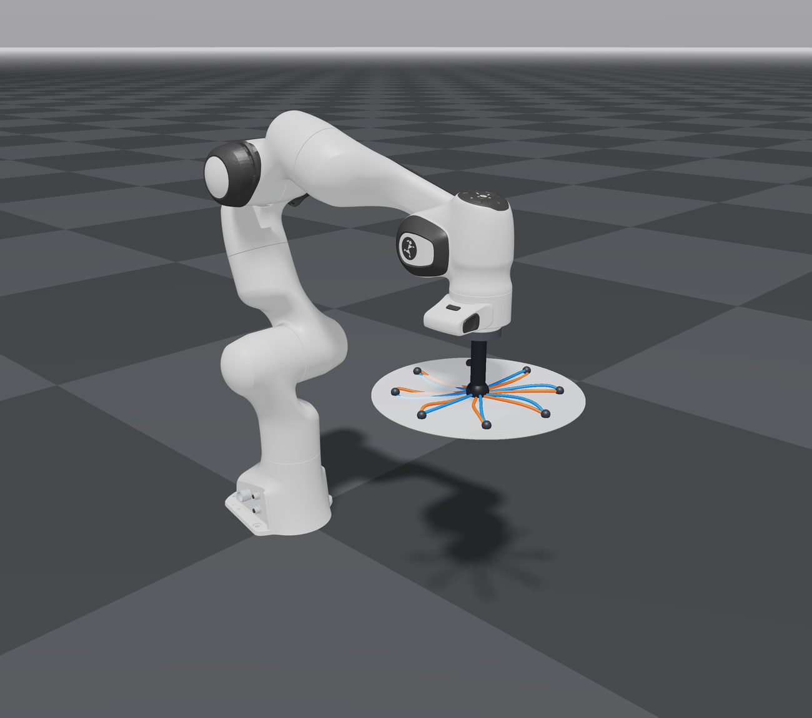
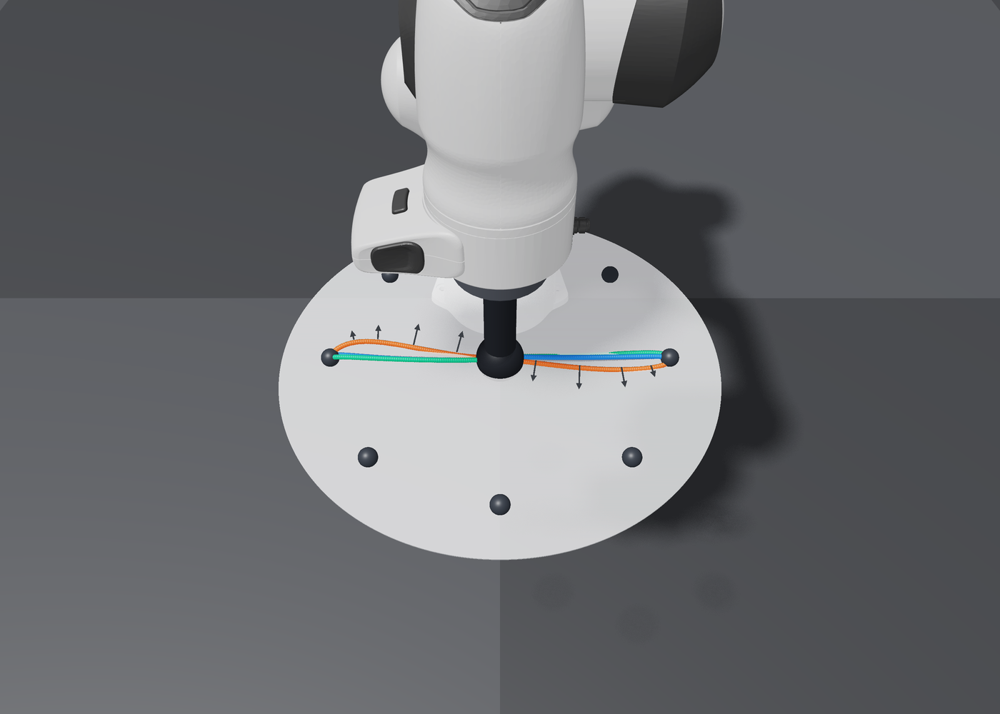
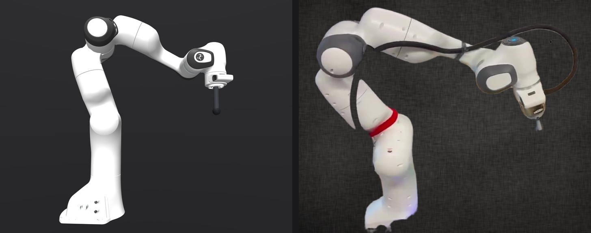

# A recurrent "motor cortex" on a Franka Panda

A 128-unit GRU learns to control an arm by backpropagation through a differentiable plant. The plant is first a
six-muscle human arm, then a torque-controlled 7-DoF Franka Panda in MuJoCo MJX. The trained network is put through
the curl force-field experiment of motor neuroscience (Shadmehr & Mussa-Ivaldi 1994). After meta-training on
episodes of random force fields, the same network adapts *within* an episode with its weights frozen. It then runs
on a real Panda as a 1 kHz `franka_ros` controller.

If this project is useful in your work, please [cite it](#citation).

<p align="center">
  
  <br><em>The deployed GRU controller on a real Panda: 6 cm reaches out and back from the start posture (real time,
  background masked).</em>
</p>

## Results

### In simulation

**Human-like adaptation by learning.** Learning by weight updates, both plants show the signatures of human
force-field adaptation. The channel-trial adaptation index rises to 0.79 (human arm) and 1.04 (Panda), after-effects
are mirror images of the first exposure, and channel forces follow the field (r ≥ 0.99).

<p align="center">
  
  <br><em>Baseline, curl field on, after 150 learning updates, field off (top left to bottom right). Hand paths seen
  from above.</em>
</p>

**Adaptation in context, with frozen weights.** Meta-trained across random fields, the GRU cuts its lateral error
from 8.5 to 2.6 mm after a single reach. A tuned Slotine–Li adaptive controller, given the field's exact structure,
needs about five reaches and 6.4× the effort. Memory is the mechanism: a memoryless MLP with the same training does
not adapt.

<p align="center">
  
  <br><em>Frozen weights in a curl field (orange arrow: the field's push). The deviation shrinks over the episode.</em>
</p>

**Only as general as its training.** Under a constant push, outside the trained family, the GRU's inference makes
things worse over reaches (4.7 → 17 mm). Training on a broader family fixes that. With 256 units, one generalist
network then matches the specialist on every velocity field.

<p align="center">
  
  
  <br><em>First reach in the field (orange), fifth reach (blue), first reach after the field is switched off (green),
  no field (grey); arrows show the field's push. Rendered with NVIDIA Newton.</em>
</p>

### On the real robot

<p align="center">
  
  <br><em>The training model in simulation (left) and the real arm (right) at the start posture.</em>
</p>

- **The controller.** The network runs every 10 ms inside Franka's 1 kHz loop. It sees the previous period's
  sensing, which is the delay it was trained with.
  - Its torque is capped and rate-limited.
  - A virtual curl field acts at the hand through the flange Jacobian.
  - Its C++ core reproduces the Python policy to 8×10⁻¹⁴ N·m.
  - A MuJoCo harness compiled from the real controller source runs whole episodes without ROS.
- **The sim-to-real gap is torque delivery.** Undamped, the first real reach grew a 3 Hz vertical oscillation and
  tripped after 0.68 s. Rigid-body plant fits reproduce it only with an effective torque-delivery lag of about
  45 ms on at least one shoulder or elbow joint, yet the robot's torque sensors show 0–20 ms. The lag stands in for
  dynamics the rigid model lacks, plausibly joint elasticity.
- **Damping fixes it, at a cost.** The fitted plants predicted that k = 12 N·m·s/rad of controller-added joint
  damping would be enough. The robot needed k = 20, which brought the vertical swing down to 7.5 mm and the endpoint
  error to 2–4 mm, with reaches about 30% slower.
- **It still adapts.** In a pre-registered balanced session (20 null/curl pairs, 40 episodes, no trips), the
  curl's deflection at peak speed shrinks from 2.69 mm on the first outward reach to 0.86 mm on the sixth. The
  pre-registered decline is 1.49 mm (95% CI 1.11–1.81), 1.5–2.5× what simulation predicted.
- **In progress: is it an internal model?** A pre-registered catch-trial session switches the field off on the sixth
  reach. An after-effect there would mean a learned feedforward compensation; none would mean a stiffer or faster
  reaction. Hypotheses, predictions and outcomes are written down before every run in
  [robot/tests/PREDICTIONS.md](robot/tests/PREDICTIONS.md).

Methods, full tables and caveats: [docs/EXPERIMENTS.md](docs/EXPERIMENTS.md) (simulation) and
[robot/README.md](robot/README.md) (controller and hardware).

## Repository layout

```
sim/                          JAX/MJX models, training and experiments; scripts write to sim/out/
  arm.py, cortex.py           human arm (six Hill-type muscles, delayed sensing) and its GRU
  train.py, adapt.py          train the GRU, then adapt it to a curl field by weight updates
  panda.py, panda_cortex.py   differentiable torque-controlled Panda (MJX) and its GRU
  panda_train.py, panda_adapt.py
  meta.py, meta_train.py      meta-training across random force fields (in-context adaptation)
  compare*.py                 frozen networks against impedance and Slotine–Li adaptive control
  s2r.py, s2r_eval.py         sim-to-real randomisation and held-out evaluation in plain MuJoCo
  policy_numpy.py             the policy in NumPy, as the robot runs it
  export_weights.py           policy -> weight file for the C++ controller
  figures.py, *_figures.py, *video.py
  out/                        trained policies, result files and figures
robot/                        franka_ros controller (C++), operator script, harness, hardware analysis
docs/                         detailed experiments, images
```

## Setup

```bash
git clone https://github.com/Anirudha-kw/motor-cortex-gru && cd motor-cortex-gru
pip install -r requirements.txt
pip install -U "jax[cuda12]"        # JAX for your accelerator; training needs a GPU
git clone https://github.com/google-deepmind/mujoco_menagerie ~/mujoco_menagerie   # the Panda model
```

Tested with Python 3.12, JAX 0.10.2 (CUDA 12), MuJoCo and MJX 3.10, optax 0.2.8, NumPy 2.5 and matplotlib 3.11.
`PANDA_XML` overrides the Menagerie path. The videos need ffmpeg.

## Reproduce

**Figures and tables from the included results** (no training):

```bash
cd sim
python figures.py && python figures.py --robot panda      # learning by weight updates: arm, Panda
python compare_figures.py                                 # in-context adaptation vs classical control
python compare_broad_figures.py && python compare_scale_figures.py
python s2r_summary.py                                     # sim-to-real held-out test
```

**Training and experiments.** Commands for each experiment are in [docs/EXPERIMENTS.md](docs/EXPERIMENTS.md). On
one GPU: about 4 min for the human arm, 15 min for the Panda baseline, and 1 h per meta-trained policy (L40S).
`sim/run_slurm.sbatch` runs any of them on a SLURM cluster.

**The robot controller without a robot.** This builds and runs the C++ core test and the closed-loop MuJoCo harness
(needs g++ and Eigen):

```bash
MUJOCO_PKG=$(python -c "import mujoco, os; print(os.path.dirname(mujoco.__file__))") bash robot/tests/run_harness.sh
```

**On a real Panda:** [robot/ROBOT_COMMANDS.md](robot/ROBOT_COMMANDS.md).

## Limitations

- The hardware results come from one trained seed, and the effects are a few millimetres.
- At k = 20 the controller's damping does part of the job the policy was trained to do, and reaches are about 30%
  slower than in training. Retraining with that damping in the loop stalled: gradients through the 8.4 s episode
  explode near the stability boundary.
- The comparison with classical control is in simulation. The classical gains were tuned by hand while the GRU is
  optimised for effort, and meta-training costs about 10⁷ simulated reaches.
- The human-arm model departs from human data: no learned co-contraction, weak rotational population dynamics, and
  over-compensation with long training (details in [docs/EXPERIMENTS.md](docs/EXPERIMENTS.md)).
- The real-robot logs (about 275 MB) are not in the repository.

## Citation

If you use this code or build on its results, please cite:

```bibtex
@misc{karande2026motorcortex,
  author       = {Karande, Anirudha},
  title        = {A Recurrent Motor-Cortex Model on a {Franka Panda}},
  year         = {2026},
  howpublished = {\url{https://github.com/Anirudha-kw/motor-cortex-gru}},
  note         = {{GitHub} repository}
}
```

GitHub's **Cite this repository** button, generated from [CITATION.cff](CITATION.cff), gives the same reference in APA
and BibTeX.

## License

MIT, see [LICENSE](LICENSE). The Panda model comes from
[MuJoCo Menagerie](https://github.com/google-deepmind/mujoco_menagerie) (Apache-2.0) and is downloaded separately.
