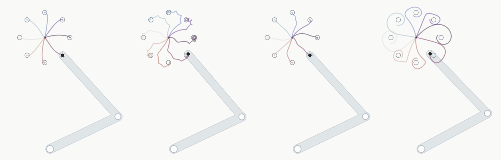
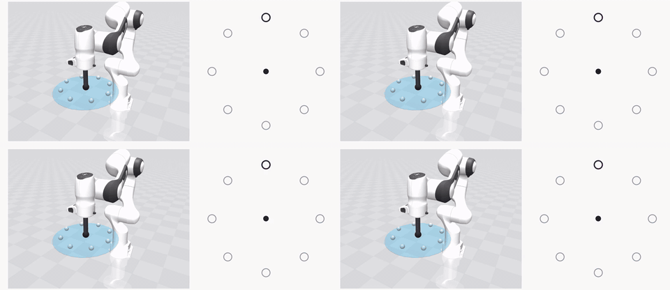
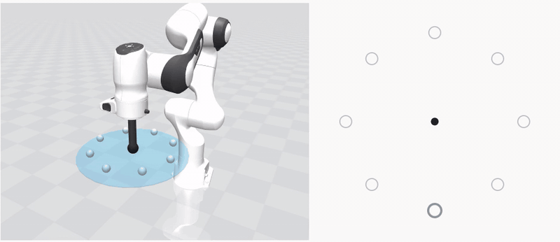

# Experiments in simulation

Detailed methods and results for the simulated experiments. All scripts are in `sim/` and write to `sim/out/`; the
trained policies and result files behind every table here are included, so the figure scripts run without training.

1. [Human arm: force-field adaptation by learning](#human-arm-force-field-adaptation-by-learning)
2. [The same experiment on a 7-DoF Franka Panda](#the-same-experiment-on-a-7-dof-franka-panda)
3. [In-context adaptation: meta-trained GRU vs classical control](#in-context-adaptation-meta-trained-gru-vs-classical-control-panda)
4. [Fixing the failure case: constant forces and payloads](#fixing-the-failure-case-training-on-constant-forces-and-payloads)
5. [Longer training or a larger network?](#longer-training-or-a-larger-network)
6. [Sim-to-real retraining for the real Panda](#sim-to-real-retraining-for-the-real-panda)

## Human arm: force-field adaptation by learning

A recurrent network learns to control a muscle-driven arm by optimization, then is put through the classic
force-field adaptation experiment (Shadmehr & Mussa-Ivaldi 1994).

### Model

- **Arm** (`arm.py`, JAX). Planar shoulder and elbow with Li & Todorov (2004) segment parameters.
  - Six muscles with constant moment arms: shoulder, elbow and biarticular, each as a flexor/extensor pair.
  - First-order activation dynamics (15 ms activation, 50 ms deactivation).
  - Hill-type force–velocity: active muscle resists stretch.
  - Delayed, noisy feedback: proprioception 30 ms, vision 70 ms.
  - Signal-dependent motor noise.
  - A curl field `F = 13 [[0, 1], [-1, 0]] v` N·s/m, or a force channel for probe trials.
- **Controller** (`cortex.py`). A GRU with 128 units.
  - Input: the target, a go cue, delayed vision and spindle-like muscle length and velocity.
  - Output: six muscle excitations.
- **Optimization.**
  - Cost: distance to the goal, plus muscle effort, plus small penalties on hidden-state size and rate of change.
  - Training: backpropagation through the arm over 1.5 s trials, 4000 Adam steps, batch 512 (`train.py`).
  - Training reaches: random reaches across the workspace, half with random force pulses (≤10 N, 50–300 ms) and 10% catch trials.
  - The network never sees a curl field during training.

### Experiment (`adapt.py`)

Centre-out reaches to 8 targets at 10 cm, in four stages:
1. Baseline.
2. Curl field on, 150 learning updates.
3. Field off, 150 washout updates.

Learning is Adam (lr 1e-4) on all weights, 128 noisy reaches per update. After every update, noise-free probe reaches measure:
- lateral error at peak speed;
- the adaptation index from force-channel trials (Scheidt et al. 2000);
- co-contraction.

<p align="center">
  
  <br><em>Hand paths in the four stages: baseline, curl field on, after 150 learning updates, field off.</em>
</p>

### Results (`figures.py` prints these)

Figure: [`sim/out/forcefield_adaptation.png`](../sim/out/forcefield_adaptation.png).

| | Baseline | First exposure | After learning | After-effect | End of washout |
|---|---|---|---|---|---|
| Lateral error at peak speed | — | −15.1 mm | +1.6 mm | +23.5 mm (mirror image) | +1.2 mm |
| Max lateral error | 9.4 mm | 36 mm | 11 mm | 47 mm | — |
| Final distance to target | 0.4 mm | 4.6 mm | 1.1 mm | 17.8 mm | — |
| Adaptation index (channel) | 0.02 | 0.02 | 0.79 | — | 0.04 |

- **Speed profiles.** Baseline speed profiles are bell-shaped: peak 0.54 m/s, movement time about 400 ms, onset about 90 ms after the go cue. None of this is imposed by the cost; it emerges from the optimization.
- **Internal model.** In channel trials after learning, the arm's lateral force follows the force that would cancel the field (correlation 0.990, peak 5.0 N vs 5.9 N ideal). That is a predictive internal model, not a stiffer arm.

### What does not match human data

- **Baseline curvature.** Paths curve about 9 mm on 10 cm reaches. This is typical of effort-optimal control (cf. Uno, Kawato & Suzuki 1989); human paths are straighter.
- **After-effect shape.** After-effect reaches curl into the target in loops larger than human hooks, and are still 18 mm out 1.3 s after the go cue.
- **No learned co-contraction.** Co-contraction does not rise early in learning (Franklin et al. 2003). The 0.011 → 0.006 drop happens on the first Adam step and is an optimizer artifact.
- **Re-optimization with long training.** Learning longer re-optimizes past what people do. After 400 updates the adaptation index reaches 1.08, field reaches over-compensate by 11 mm, and after-effect reaches no longer settle (75 mm out). Restricting plasticity to the input, recurrent or readout weights changes the speed of this but not its pattern.
- **Weak rotational dynamics.** The network shows little rotational population structure (Churchland et al. 2012). A skew-symmetric jPCA fit explains R² = 0.12 against 0.40 for an unconstrained linear fit.
- **Updates are not trials.** Each update averages 128 reaches, so time courses are not comparable to human trial counts.

### Run (from `sim/`)

```bash
export XLA_PYTHON_CLIENT_PREALLOCATE=false
python train.py      # ~4 min on an RTX 2070 Super -> out/cortex_baseline.npz
python adapt.py      # ~1 min -> out/adaptation.npz
python figures.py    # -> out/forcefield_adaptation.png (+ printed statistics)
python video.py      # -> out/forcefield_reaching.mp4 (four stages side by side, real time)
```

## The same experiment on a 7-DoF Franka Panda

### Plant (`panda.py`)
- Menagerie MJX Panda without the hand.
- Position servos removed: the network commands the 7 joint torques, within the Panda's 87 / 12 N·m limits, through a 10 ms torque lag.
- Gravity compensated, as Franka's controller does.
- Joint damping 1 N·m·s/rad and armature 0.1.
- Collisions and constraint solving off, so the dynamics are differentiable. Joint stops are stiff springs beyond the limits.
- The "hand" is a handle 10 cm past the flange.
- Sensing: joint encoders and handle position, 10 ms delay.

### Field scaling
The Panda's horizontal endpoint mass is 2.7× the human model's (2.2–3.6 kg vs 0.65–1.5 kg), so:
- curl field 13 × 2.72 = 35 N·s/m;
- channel 6000 N/m;
- training pulses up to 27 N.

### Controller (`panda_cortex.py`)
The same 128-unit GRU, cost and delayed-reach task. The differences:
- a tanh readout to joint torques;
- a weak posture cost for the 7-DoF null space;
- the initial readout scaled by 0.1, because random torques made the arm flail and diverge.

### Training and experiment (`panda_train.py`, `panda_adapt.py`)
- **Training:** 4000 Adam steps at batch 256, 198 ms per step on an L40S (about 2.5 min compile + 13 min).
- **Experiment:** the same 150 + 150 update protocol as the human model.

| Panda | Baseline | First exposure | After learning | After-effect | End of washout |
|---|---|---|---|---|---|
| Lateral error at peak speed | — | −10.1 mm | +5.3 mm | +16.1 mm (mirror image) | +3.3 mm |
| Max lateral error | 3.0 mm | 15 mm | 7 mm | 22 mm | — |
| Final distance to target | 0.1 mm | 0.1 mm | 0.1 mm | 0.5 mm | — |
| Adaptation index (channel) | −0.01 | −0.01 | 1.04 | — | 0.14 |

- **Internal model.** The channel force after learning follows the ideal compensation (correlation 0.992, peak 31 N vs 28 N).
- **Rotational dynamics.** Population activity shows more rotational structure than the human model (jPCA skew R² 0.34 vs 0.77 unconstrained), still below monkey M1.

Figure: [`sim/out/panda_forcefield_adaptation.png`](../sim/out/panda_forcefield_adaptation.png).

<p align="center">
  
  <br><em>Baseline, curl field on, after 150 learning updates, field off (top left to bottom right). Hand paths seen from above.</em>
</p>

### Differences from the human model
- **Faster learning.** With the identical learning rule the Panda adapts about twice as fast (index 0.78 at update 76 vs 0.49), so within 150 updates it over-compensates (index above 1). That is the re-optimization effect the human model showed only with longer training.
- **Tighter feedback.** After-effect reaches still land on the target (0.5 mm), and first-exposure errors are smaller. The cause is 10 ms sensing with torque motors, against 30–70 ms delays with muscles.
- **Straighter and faster reaches.** Paths deviate 3 mm vs 9 mm. Speed is 0.86 m/s peak in 252 ms, because the effort weight was not retuned for the robot. Since the curl force scales with speed, the robot meets a proportionally stronger push.

### Run

```bash
# from sim/, on a GPU (about 15 min on an L40S for training)
python panda_train.py --iterations 4000 --batch 256         # -> out/panda_baseline.npz
python panda_adapt.py --params out/panda_baseline.npz       # -> out/panda_adaptation.npz
python figures.py --robot panda   # -> out/panda_forcefield_adaptation.png
python panda_video.py             # -> out/panda_forcefield_reaching.mp4
```

## In-context adaptation: meta-trained GRU vs classical control (Panda)

**Question.** Can the network adapt to a new force field within a few reaches *without weight updates*,
and is that better than the classical alternatives?

### Training (`meta.py`, `meta_train.py`, about 1 h per policy on one L40S)
- **Episodes:** 10 consecutive reaches. The hidden state is never reset between reaches, and the arm continues from where the last reach ended.
- **Fields:** one random force field per episode, a curl in [−50, 50] N·s/m plus a viscous part with eigenvalues in [−25, 5] N·s/m. 20% of episodes have no field, and 30% switch field partway through.
- **Extra input:** an efference copy of the network's previous torque command.
- **Controls:**
  - the same training with a memoryless MLP;
  - the same GRU and episodes with no fields at all.

### Test (`compare.py`)
- Frozen controllers, 32 episodes of out-and-back reaches, identical episodes and noise for every controller.
- **Impedance:** task-space impedance tracking a minimum-jerk path, at 400 or 1800 N/m.
- **Adaptive:** Slotine–Li adaptive control with the exact velocity-field regressor. Its gain was tuned on separate episodes; 2e3 is an interior optimum, since 3e3 is worse and 1e4 or more is unstable with the 10 ms delay.

**|Lateral error at peak speed| [mm] on outward reaches 1 → 2 → 6, and effort (mean squared normalised torque):**

| Field | GRU meta-trained | Adaptive (Slotine–Li) | Impedance, stiff | MLP meta-trained | GRU no fields |
|---|---|---|---|---|---|
| curl +35 | **8.5 → 2.6 → 3.5**, 0.0030 | 21.5 → 8.1 → 2.6, 0.0191 | 10.3 → 9.4 → 9.1, 0.0249 | 7.0 → 5.7 → 5.7, 0.0042 | 11.8 → 9.9 → 11.2 |
| curl −35 | **7.7 → 2.6 → 3.5**, 0.0030 | 21.0 → 6.7 → 2.4, 0.0182 | 10.2 → 9.4 → 9.4, 0.0242 | 6.2 → 3.7 → 4.1, 0.0041 | 11.3 → 10.8 → 8.8 |
| mixed (curl + viscous) | **6.8 → 3.1 → 3.6**, 0.0028 | 16.5 → 7.4 → 2.5, 0.0158 | 8.1 → 7.9 → 8.1, 0.0139 | 5.8 → 4.8 → 5.1, 0.0037 | 9.4 → 7.5 → 8.9 |
| curl +70 (1.4× the trained maximum) | **13.7 → 2.8 → 3.4**, 0.0054 | 39.8 → 12.8 → 5.2, 0.0456 | 19.7 → 13.6 → 14.2, 0.3161 | 10.6 → 8.2 → 7.8, 0.0087 | unstable (final error 41 mm) |
| constant 15 N push (outside the family) | 4.7 → 14.7 → 17.0, final error 15.9 mm | 14.4 → 17.9 → 14.9, final error 30.8 mm | **5.0 → 5.2 → 5.8**, final error 8.3 mm | 6.5 → 12.9 → 12.5 | 9.5 → 18.6 → 21.9 |

<p align="center">
  
  <br><em>Frozen weights in a curl field (orange arrow: the field's push). The deviation shrinks over the episode.</em>
</p>

Figure: [`sim/out/incontext_comparison.png`](../sim/out/incontext_comparison.png).

### What this shows
- **One-reach adaptation in its hidden state.** Inside the training family the meta-trained GRU adapts after a single reach, with frozen weights. It is the only controller that reaches the ≤5 mm criterion (by reach 3). The tuned classical adaptive controller reaches the same late-reach error only after about 5 reaches, using about 6× the effort.
- **Memory is the mechanism.** The meta-trained MLP gets the same training but has no memory, so it cannot adapt across reaches. The GRU trained without fields does not adapt either.
- **Bigger fields work too.** The adaptation still works beyond the training range (curl +70, 1.4× the trained maximum of 50), where stiff impedance saturates the torques and the no-field GRU goes unstable.
- **A clear after-effect.** When the field is switched off the meta-GRU errs in the mirror direction (+6.4 mm) and de-adapts within about 2 reaches; the classical adaptive controller shows +11.6 mm. That is evidence the hidden state holds a predictive compensation.
- **It fails outside the trained family.** Under a constant push the meta-GRU's inference makes things worse after the first reach (4.7 → 17 mm). Stiff impedance is the robust choice there. In-context adaptation is only as general as the training distribution.

### Caveats
- Effort favours the GRU partly because it is optimised for effort, while the classical gains were chosen by hand.
- Meta-training costs about 10 million simulated reaches offline; the classical controllers need no training.
- In the null field the meta-GRU is less accurate than stiff impedance (2–3 mm vs 1.3 mm), at about a quarter of the effort.
- Simulation only.

### Run (from `sim/`, on a GPU; about 1 h per policy on an L40S)

```bash
python meta_train.py --policy gru --fields meta --tag gru_meta     # -> out/meta_gru_meta.npz
python meta_train.py --policy mlp --fields meta --tag mlp_meta
python meta_train.py --policy gru --fields null --tag gru_null
python compare.py                                                  # -> out/comparison.{npz,json}
python compare_figures.py                                          # -> out/incontext_comparison.png
```

## Fixing the failure case: training on constant forces and payloads

### What changed
- **Training family (`meta.py`, `--fields broad`):** velocity fields as before, plus constant forces up to 20 N in any direction, plus payloads of 0.2–2 kg. Each is present in about half of the episodes, in random combinations, and 30% of episodes switch everything at a random reach (as when an object is picked up or dropped).
- **Payload physics:** a payload is a real sphere at the handle whose mass and inertia change per episode (exact rigid-body dynamics in MJX, checked against MuJoCo to 6e-7). Its weight is a force the robot's gravity compensation does not know about.
- **Classical baseline:** the Slotine–Li controller now estimates a velocity field, a constant force and the payload mass. Each gain was tuned on separate episodes with grids extended until interior optima appeared (velocity 2000, constant 300, mass 0.3; mass adaptation from noisy accelerations does not pay, so the constant-force term absorbs the weight).
- **Metric:** the 3-D distance from the straight path, which also sees a payload's sag.
- **Training stability:** training skips non-finite updates (`optax.apply_if_finite`). Zero were skipped in both runs.

### Results (`compare_broad.py`; reach 1 → 2 → 6, final distance to target, effort ×10³)

| Condition | GRU, broad | GRU, velocity fields only | MLP, broad | Impedance, stiff | Adaptive (Slotine–Li) |
|---|---|---|---|---|---|
| push 15 N, max 3-D deviation [mm] | **7.3 → 7.0 → 6.3**, final **0.6**, 4.5 | 9.5 → 20.5 → 25.1, final 15.9, 10.3 | 8.4 → 8.3 → 8.6, final 2.4, 8.1 | 5.8 → 6.2 → 6.7, final 8.3, 15.9 | 12.8 → 5.5 → **4.6**, final 2.8, 15.4 |
| payload 1.5 kg | **9.8 → 6.5 → 6.5**, final **0.6**, 5.1 | 23.2 → 22.7 → 23.3, final 9.3, 11.0 | 9.9 → 9.6 → 10.0, final 1.2, 8.1 | 8.9 → 8.9 → 9.0, final 8.1, 41.6 | 16.4 → 6.3 → **5.4**, final 4.5, 39.4 |
| payload + curl +35 | **10.8 → 9.0 → 9.0**, final **0.7**, 6.3 | 26.4 → 23.0 → 25.3, final 9.8 | 14.5 → 14.5 → 12.7, final 1.4 | 14.7 → 14.9 → 14.6, final 8.1 | 22.6 → 10.6 → 8.2, final 6.0, 49.3 |
| curl +35, horizontal lateral [mm] | 5.4 → 3.8 → 4.8 | 8.5 → **2.6 → 3.5** | 6.4 → 4.8 → 5.1 | 10.3 → 9.4 → 9.1 | 19.5 → 7.2 → 4.4 |
| curl +70 (1.4× trained max), lateral | 8.5 → 5.9 → 7.0 | 13.7 → **2.8 → 3.4** | 11.9 → 7.7 → 7.2 | 19.7 → 13.6 → 14.2 | 35.3 → 10.7 → 6.5 |
| spring 300 N/m (outside everything), max 3-D | 10.5 → 10.6 → 7.3, final **4.0** | 26.8 → 32.6 → 23.2, final 22.1 | 10.8 → 13.3 → 10.8, final 10.7 | **5.1 → 5.4 → 5.8**, final 12.6 | 9.9 → 10.6 → 10.4, final 12.6 |

### What this shows
- **The failure is fixed.**
  - Under the constant push, the old GRU drifted to 25 mm and ended 15.9 mm off target; the broad GRU stays near 6–7 mm and ends 0.6 mm off.
  - With a payload, the old GRU sagged 23 mm; the broad GRU drops to 6.5 mm after one reach.
- **Against classical control.**
  - **Where the GRU wins:** it has the best first reach, by far the best final accuracy (0.6 mm, against 2.8–8.3 mm), and uses 3–8× less effort.
  - **Where the adaptive controller wins:** given the exact structure of these disturbances, it also converges within a reach and then has slightly smaller mid-reach deviation (push 4.6 vs 6.3 mm; payload 5.4 vs 6.5 mm).
- **Static disturbances do not need memory.** The memoryless MLP copes with the push and the payload (final error 1.2–2.4 mm) because the torque needed to hold still reveals them (efference copy). It does not improve across reaches; the GRU does on the payload (9.8 → 6.5 mm).
- **The cost: weaker velocity-field adaptation.** The broad GRU's first reach in a curl field is better (5.4 vs 8.5 mm), but its adapted level is worse (4.8 vs 3.5 mm), and it has lost the extrapolation to curl +70 (7.0 vs 3.4 mm). With the same training budget the generalist is less specialised.
- **Outside every family it degrades gracefully.** In the position-dependent spring it is not best on path deviation (stiff impedance is) but ends closest to the target (4.0 mm, against 12.6 mm or more for the rest).
- **Dropping the payload:** the broad GRU barely reacts (+1 mm), because the holding torque reveals the change at once. The adaptive controller's mass and force estimates throw the next reach 15 mm off.

### Videos (`compare_video.py`)
Real time, four controllers side by side; robot plus top-down paths, environment force as an orange arrow. It writes
`out/video_push_15_N.mp4` (the old failure case), `out/video_payload_1p5_kg.mp4`, `out/video_curl_plus35.mp4` and
`out/video_spring_300_Nperm.mp4` (needs ffmpeg).

Figure: [`sim/out/broad_comparison.png`](../sim/out/broad_comparison.png).

### Run (from `sim/`)
```bash
python meta_train.py --policy gru --fields broad --tag gru_broad
python meta_train.py --policy mlp --fields broad --tag mlp_broad
python compare_broad.py
python compare_broad_figures.py; python compare_video.py
```

## Longer training or a larger network?

**Question.** The broad-family GRU fixed the push and payload failures but adapted less well to velocity
fields than the specialist. Does capacity or training time remove that trade-off?

**Runs** (`meta_train.py --fields broad`, same episodes and seed, RTX PRO 6000, 0.9 s per step):
- 128 units for 4k steps (the original);
- 128 units for 12k steps;
- 256 units for 4k steps;
- 256 units for 12k steps.

`compare_scale.py` uses the conditions, episodes and noise of `compare_broad.py`, and the adaptive gains
tuned there.

**Mean error on outward reaches 2–6 [mm]** (velocity fields: horizontal lateral error at peak speed;
others: maximum 3-D deviation). Final distance to target is 0.4–0.6 mm for every GRU except in the spring.

| Model | curl +35 | curl −35 | mixed | curl +70 (1.4× trained max) | push 15 N | payload 1.5 kg | payload + curl | spring (outside) |
|---|---|---|---|---|---|---|---|---|
| GRU 128, 4k steps | 4.4 | 3.1 | 3.9 | 6.9 | **6.3** | 6.5 | 9.0 | 8.6 |
| GRU 128, 12k steps | 3.5 | 3.3 | 3.3 | 3.2 | 7.3 | 5.8 | **7.3** | 8.3 |
| **GRU 256, 4k steps** | **2.5** | **2.7** | **2.4** | **2.5** | 7.4 | 6.5 | 7.7 | 6.9 |
| GRU 256, 12k steps | 7.0 | 7.9 | 6.6 | 6.8 | 7.8 | **5.5** | 11.1 | 9.2 |
| GRU velocity fields only (specialist) | 2.8 | 2.8 | 2.8 | 2.6 | 23.5 | 22.9 | 23.7 | 28.4 |
| Impedance, stiff | 9.4 | 9.4 | 8.1 | 14.2 | 6.3 | 9.0 | 14.7 | **5.5** |
| Adaptive (Slotine–Li) | 5.1 | 4.8 | 4.4 | 8.2 | 4.8 | 5.7 | 9.0 | 10.7 |

### What this shows
- **Capacity removes the trade-off.**
  - With 256 units and the same 4k-step budget, the generalist matches the specialist on every velocity
    field, including curl +70 beyond the trained range (2.5 vs 2.6 mm).
  - It keeps the broad family's robustness: final error 0.4–0.6 mm under the push and the payload, against
    9–16 mm for the specialist.
  - Against the 128-unit original it costs about 1 mm on the push (7.4 vs 6.3).
- **Training 3× longer at 128 units gets most of the way**: 3.2–3.5 mm on velocity fields, and the
  extrapolation to curl +70 is restored (3.2 vs 6.9).
- **More is not monotone.** Training the 256-unit network 3× longer undid its velocity-field adaptation:
  - The first reach is the best of all (2.2–3.2 mm), but the error then *grows* over reaches (to 6–8 mm).
  - The training-log probe shows the adaptation peaked near 5000 steps (curl +35: 2.8 → 2.0 → 2.1 mm) and
    degraded after about 6000 steps, while the payload error kept improving.
  - The long tail of training spent the network on the dominant part of the cost (loads, null field) at
    the expense of the rarer velocity-field inference.
  - So pick checkpoints on a held-out probe of every family, not by training cost.
- **Outside every family**, in the spring field, every broad GRU still ends 2–4 mm from the target (stiff
  impedance 12.6 mm). The bigger or longer-trained networks end closer (2.0–2.6 mm).

Figure: [`sim/out/scale_comparison.png`](../sim/out/scale_comparison.png) (`compare_scale_figures.py`).

```bash
python meta_train.py --policy gru --fields broad --hidden 128 --iterations 12000 --tag gru_broad_h128_12k
python meta_train.py --policy gru --fields broad --hidden 256 --iterations 4000 --tag gru_broad_h256_4k
python meta_train.py --policy gru --fields broad --hidden 256 --iterations 12000 --tag gru_broad_h256_12k
python compare_scale.py && python compare_scale_figures.py
```

On a SLURM cluster, `run_slurm.sbatch` runs any of these: `SCRIPT=meta_train.py ARGS="..." sbatch --export=ALL
run_slurm.sbatch`.

## Sim-to-real retraining for the real Panda

**Question.** The broad 128-unit GRU was trained on one nominal arm. What does it need before it can drive a real
Panda through `franka_ros`?

### Training (`s2r.py`, `meta_train.py --s2r`)
- **Randomised plants.** The broad network is fine-tuned for 6000 steps on plants that differ per episode in Coulomb
  friction (up to 1.5 N·m), viscous damping (×0.5–2), torque bias and gain (0.9–1.1), link masses (±15%), an
  unmodelled tool (up to 0.6 kg) and torque lag (5–20 ms). The ranges grow from 0 over the first 1000 steps.
- **The deployment controller's limits in the loop:** torque caps and a 1 N·m/ms rate limit.
- **Fixed sensing delay.** Randomising the sensing delay made gradients through the 840-step closed loop explode
  (norms 10⁹–10¹¹ against 0.04). The delay is fixed at 10 ms, and the robot controller imposes exactly that delay.
- **Gradient spikes.** Even with the delay fixed, about 6% of batches had gradient spikes up to 6×10⁴
  (`s2r_diag2.py`). Clipping them wrecked the policy, and cutting the gradient at reach boundaries biased it.
  What works: full-horizon backpropagation, skipping updates whose norm exceeds 5× the median of the last 50
  (`--spike-factor 5`).

### Held-out test (`s2r_eval.py`, `s2r_summary.py`)
Plain MuJoCo (not MJX) plants built to differ from training the way a real Panda does: configuration-dependent
gravity-compensation error, constraint-based joint friction (Gaz et al. 2019), real payloads, and the robot's 1 kHz
loop with the policy at 100 Hz. No run went unstable.

| Policy | final error, random plants | worst lateral error |
|---|---|---|
| broad GRU, before randomisation | 1.5 mm | 10.9 mm |
| control: limits only, no randomisation (`nomlimR_s1`) | 1.4 mm | 17.4 mm |
| **randomised (`s2rR_s1`, deployed)** | **0.9 mm** | **7.9 mm** |
| randomised without bias and viscous terms (`s2rL_s1`) | 0.8 mm | 6.4 mm |

In-context curl adaptation is kept. `s2rR_s1` went to the robot, exported with `export_weights.py` to
`robot/weights/`. What happened there is in the main README and [robot/README.md](../robot/README.md).

### What did not work
Retraining with the plant fitted to the real arm, with the robot controller's damping in the loop, stalled: near the
stability boundary, backpropagation through the 8.4 s episode explodes without the arm visibly diverging (median
gradient norms 10⁷–10¹²). Those runs are not included.

### Run (from `sim/`)
```bash
COMMON="--policy gru --fields broad --hidden 128 --iterations 6000 --lr 3e-4 --init out/meta_gru_broad.npz --spike-factor 5 --log-every 50"
python meta_train.py $COMMON --s2r --seed 1 --tag gru_s2rR_s1
python meta_train.py $COMMON --s2r --s2r-drop bias,viscous --seed 1 --tag gru_s2rL_s1
python meta_train.py $COMMON --nominal-limits --seed 1 --tag gru_nomlimR_s1
python s2r_eval.py out/meta_gru_broad.npz out/meta_gru_nomlimR_s1.npz out/meta_gru_s2rR_s1.npz out/meta_gru_s2rL_s1.npz
python s2r_summary.py
python export_weights.py out/meta_gru_s2rR_s1.npz ../robot/weights/motor_cortex_s2rR_s1.mcgru
```
