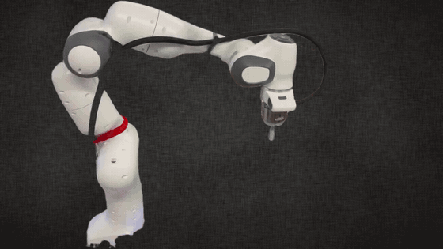

# Motor-cortex controller for the real Panda

A `franka_ros` controller (`panda_controllers/MotorCortexController`) that runs the in-context GRU "motor cortex"
(`../sim`, sim-to-real retrained: `sim/out/meta_gru_s2rR_s1.npz`) on the real arm. It's an overlay for the robot
host's existing `panda` package: five new files, the policy weights, and two additive edits (one source line, one
plugin class). Existing controllers are not touched.

  
   <em>The controller on a real Panda: 6 cm reaches out and back (real time).</em>

## What it does

- **The policy runs inside the 1 kHz real-time loop**, every 10th tick (100 Hz). It's fed the sensing of the previous
  10 ms period, which is the exact delay it was trained with. The robot itself senses in 1–2 ms, so the delay is
  imposed in code (`motor_cortex_core.h`). A 20 ms delay was untrained and degraded it in simulation.
- **Its torque goes on top of Franka's gravity compensation, with no Coriolis term added.** The policy was trained
  on a plant whose Coriolis forces it handles itself. The torque is capped (`tau_cap`) and rate-limited to 1 N·m per
  ms against `tau_J_d`, the same 1000 N·m/s as in training.
- **A virtual force field** `F = [B v_xy + c_xy, c_z]` acts at the "hand": 10 cm past the flange along its z axis.
  It's computed every 1 ms from the flange Jacobian. This plays the role of the manipulandum in the curl-field
  experiment.
- **Modes:**
  - HOLD: joint impedance where the arm is.
  - HOMING: 8 s minimum-jerk move to the trained start posture `q_home`.
  - RUNNING: an episode of n outward reaches of `reach_radius` in random directions, each followed by a return,
    0.7 s each, go cue at 100 ms.
  - TRIPPED: joint damping only, until `reset`.
- **Refusals:** an episode starts only from `q_home` (within 0.05 rad) with the arm still. Homing is refused from more
  than 1 rad away.
- **Trips:**
  - hand outside a 25 × 25 × 15 cm box around home;
  - joint speed above about 85% of the Panda's limits;
  - within 0.05 rad of a joint limit;
  - hand speed above 1 m/s;
  - non-finite policy output.

  Franka's own reflexes stay active.

## Why 6 cm reaches (not the 12 cm of the simulation probes)

In the closed-loop harness, 12 cm and 10 cm reaches drove joint speeds past 2 rad/s, near the Panda's 2.175 rad/s
limit, and tripped the controller. The policy trained on targets up to 16 cm away, so shorter reaches are
in-distribution:

| Radius | Peak hand speed | Peak joint speed | Lateral error at peak (curl field) | End error |
|---|---|---|---|---|
| 8 cm | 0.53 m/s | 1.95 rad/s | 2.4–4.2 mm | 0.6 mm |
| 6 cm | 0.40 m/s | 1.59 rad/s | 1.9–3.6 mm | 0.5 mm |

The default is 6 cm; 8 cm is allowed, and anything above 12 cm is refused.

## Verification done here (no ROS needed): `tests/run_harness.sh`

- **`test_core`:** the C++ core (GRU, sequencer, 10 ms delay) replays a closed-loop trace of the Python policy.
  Torques match to 8×10⁻¹⁴ N·m over 420 ticks, and targets and go cues match exactly. Mutation checks: removing the
  delay gives a 16.7 N·m error, removing the go cue also fails.
- **`harness`:** the real controller source, compiled against stubs that emulate franka_hw (column-major Jacobian
  and poses, `tau_J_d`), drives a MuJoCo Panda at 1 kHz. The plant has real-Panda joint friction (Gaz et al. 2019)
  and gravity compensated outside the controller. Results:
  - start refused away from home;
  - homing within 0.0074 rad;
  - a full 6-reach episode in a curl field (numbers in the table above);
  - a forced workspace trip leaves the arm stopped under damping;
  - reset returns it to hold;
  - the torque-rate limit held on every one of 29,000 ticks.

  Under the first-session caps (20/5 N·m) the behaviour is identical; peak torques were 15.5, 13.4, 11.3, 10.6,
  0.9, 2.9 and 0.1 N·m.
- **Syntax check** against minimal ROS stubs (`tests/stubs`, `-Wall -Wextra`: clean).

**On the robot:** `install_robot.sh` first builds against the real ROS Noetic, franka_ros and libfranka headers in an
isolated workspace, since the stubs mimic their APIs but can't prove them. The controller has since been built and
run on a real Panda. Real tracking differs from the harness: see "On the real robot" in the top-level README.

## Files

| File | Purpose |
|---|---|
| `include/panda/motor_cortex_core.h` | ROS-free core: weight loader, GRU, sequencer, delay |
| `include/panda/motor_cortex_controller.h`, `src/motor_cortex_controller.cpp` | the controller |
| `config/motor_cortex_controller.yaml` | parameters (all documented) |
| `config/motor_cortex_first_session.yaml` | caps 20/5 N·m, 6 cm (on by default) |
| `launch/motor_cortex_controller.launch` | franka_control and the spawner; starts in HOLD |
| `scripts/motor_cortex_experiment.py` | operator client: blocks of episodes, homes first, stops at any trip, records telemetry, the policy log and the 1 kHz log; `--pulses` for system identification in hold |
| `weights/motor_cortex_s2rR_s1.mcgru` | the policy (`sim/export_weights.py`) |
| `install_robot.sh` | isolated build (default) or install, with backup; never starts nodes or moves the robot |
| `tests/` | core test, closed-loop harness (also on a plant fitted to the real arm: `REAL_FIT`, `DAMPING_K`), stubs, reference trace |
| `tests/` (real data) | why the real arm oscillated: `replay_measured.py`, `replay_fit.py`, `invdyn_check.py`, `plant_probe.py`, `plant_fit.py`, `plant_fit2.py`, `fix_probe.py`, `fix_probe2.py`, `jitter.py`; sessions: `reach_summary.py`, `compare_real.py`, `analyze_balanced.py`, `balanced_checks.py`, `timecourse.py`, `catch_score.py` |
| `tests/` (predictions) | simulated predictions through the real controller: `gate0.py`, `balanced.py`, `probe_impedance.py`, `catch_predict.py`; written-before-the-run hypotheses and outcomes: `GATE0.md`, `PREDICTIONS.md` |

See [ROBOT_COMMANDS.md](ROBOT_COMMANDS.md) for the procedure on the robot.

## Provenance

- **The controller is the code that ran.** The headers, source, configs, launch file and weights are byte-identical
  to the version on the robot (`bundle.sha256`). The experiment script is the version that ran the balanced and
  catch-trial sessions. Comments in them that mention `forcefield_gru/` refer to this repository's `sim/`.
- **`out/` in `tests/GATE0.md` and `tests/PREDICTIONS.md` means `sim/out/`.** The simulated results they cite are
  there. The real-robot logs (`mc_*.npz`, about 275 MB) are not in the repository.
